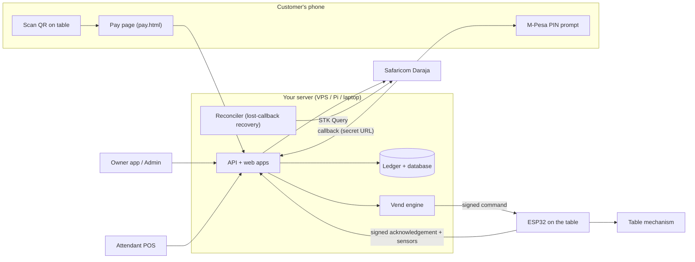
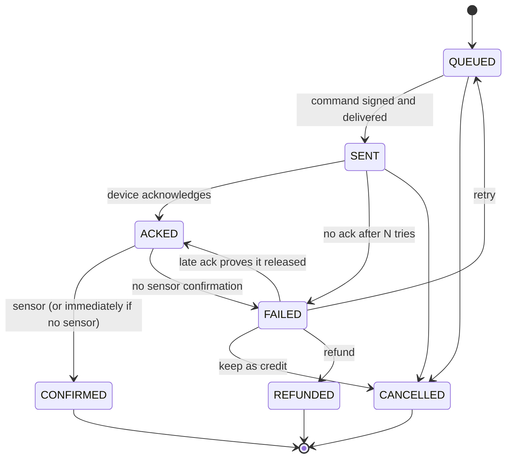

# Pool Table Payment Automation System

Open-source "virtual coin" for coin-operated tables (pool, snooker, foosball, air hockey). A player pays by **M-Pesa** (a payment prompt appears on their phone) or **cash** (an attendant confirms it), and the table releases the balls for each paid game. **There is no timer anywhere**: the table itself ends each game; the next game needs a new coin.

> **Read this first: what is and is not verified.** All server, web-app and portable-firmware logic is covered by automated tests that were really run (see [Test results](#test-results)). Everything that needs real hardware, a real phone network or real Safaricom credentials has **not** been run and must be verified on site: see [docs/VERIFICATION.md](docs/VERIFICATION.md) for the full list. Do not put real money through the system until you have completed the commissioning checklist in [docs/TABLE-INSTALLATION.md](docs/TABLE-INSTALLATION.md).

## What you get

| Part | What it does |
|---|---|
| **Server** (`src/`) | Payments (M-Pesa STK Push, optional Paybill/C2B), money & game ledger, vending engine, cash shifts, vouchers, reports, alerts, API. One process, no runtime dependencies. |
| **Customer page** (`web/pay.html`) | Scan the QR on the table, choose games, enter phone number, pay. English + Swahili. Also kiosk mode for a tablet. |
| **Attendant POS** (`web/pos.html`) | Phone-friendly cash register with shifts, receipts, voids, approvals and "my day" analytics. |
| **Admin dashboard** (`web/admin.html`) | First-run wizard, tables, prices & bundles, Daraja settings, unallocated payments, vouchers, staff, shifts, coin box, reports, audit log. |
| **Owner app** (`web/owner.html`, `android/`) | Installable phone app: games played, money earned, alerts, and an **Open table** button. Works as a PWA now; Android project included for a locked APK. |
| **ESP32 firmware** (`firmware/`) | Controls the table: coin-pulse, solenoid-slide or gate-solenoid. Verifies every command's signature; fails safe. |
| **Deployment** (`deploy/`, `Dockerfile`, `docker-compose.yml`) | Cloud VPS (Docker + automatic HTTPS), Raspberry Pi, or laptop. Encrypted daily backups with verified restore. |

## How it fits together



### Paying with M-Pesa

```mermaid
sequenceDiagram
  participant C as Customer
  participant S as Server
  participant D as Daraja
  participant E as ESP32
  C->>S: Pay 5 games (idempotency key, phone)
  S->>S: Table online? price? rate limits? save request
  S->>D: STK Push (exact amount)
  D-->>C: "Enter M-Pesa PIN"
  C->>D: PIN
  D->>S: Callback (secret URL) with receipt
  S->>S: match request, amount, phone; credit ONCE (unique receipt)
  S->>E: signed vend command (long-poll wakes instantly)
  E->>E: verify signature, expiry, nonce, limits; remember vend ID; release
  E->>S: signed ack
  S-->>C: "Payment received. Balls released, enjoy!"
  Note over S,D: If the callback is lost, the reconciler asks Daraja (STK Query) and credits anyway
```

### A vend's life



## Key safety rules (built in, tested)

- **A payment can never create more games than it paid for**: one M-Pesa receipt = one credit (database `UNIQUE`), duplicate callbacks do nothing, and the ledger refuses negative game balances.
- **Shared till protection**: only a payment that answers a push *this system* created can release games. A KES 20 drink payment on the same till lands in *Unallocated payments* and never vends. C2B on a Till never vends. The owner can manually assign one, with a reason, and that is audit-logged.
- **Signed commands**: the ESP32 refuses anything not signed with its own secret, expired, replayed, or beyond hard limits. A vend ID is saved *before* the output moves, so a power cut or a resend can never release twice.
- **Fail-safe output**: the release pin is forced off at boot, on any fault, and by a separate on-time guard.
- **Money in whole cents** (integers), a double-entry ledger that is never edited, and a hash-chained audit log that detects tampering.

## Quick starts

- **Cloud server (recommended)**: [SETUP.md](SETUP.md) → "Option A".
- **Raspberry Pi / laptop**: [SETUP.md](SETUP.md) → "Option B / C". Try it on your laptop in 2 minutes: `sh deploy/laptop/run-local.sh`, then open `http://localhost:8080/admin.html`.
- **Wire a table**: [docs/TABLE-INSTALLATION.md](docs/TABLE-INSTALLATION.md).
- **Something is wrong**: [TROUBLESHOOTING.md](TROUBLESHOOTING.md).

## Cost estimate (rough, check current prices)

| Item | Approx. cost |
|---|---|
| Cloud server (1 vCPU / 1 GB is plenty) | KES 650-1,000 per month |
| Domain name | KES 1,200-2,000 per year |
| Per table: ESP32 board, opto/relay module, 5 V/12 V supply, fuse, box, terminals, cable | KES 3,000-6,500 once |
| Raspberry Pi instead of a server | KES 9,000-14,000 once (+ SSD recommended) + free Cloudflare Tunnel |
| M-Pesa fees | Per Safaricom's business tariff; paid by the business per transaction |
| Software | Free (MIT licence) |

## Repository map

```
src/core      business logic (ledger, pricing, credit, vend engine, cash, STK/C2B, auth, devices, reports)
src/server    HTTP framework + all API routes        src/sim  ESP32 behavioural simulator    src/ops  backup/restore
web/          customer, POS, admin, owner (PWA), QR sheet; no build step, no framework
firmware/     PlatformIO project; lib/pooltable_core = portable, PC-tested logic; src/main.cpp = hardware glue
android/      owner app (Kotlin WebView shell)       deploy/  Caddy, systemd, Pi, laptop
migrations/   versioned SQL                           tests/   every automated test
docs/         architecture, security, payments, cash POS, operations, installation, API (openapi.json), decisions, verification
```

## Test results

Real runs, recorded in `docs/`:

| Suite | Result | Output file |
|---|---|---|
| Server + web (Node test runner, 141 tests incl. concurrency across real DB connections, fake-Daraja scenarios, security, E2E with the device simulator, page flows) | 141 pass | `docs/FINAL-TEST-OUTPUT.txt` |
| ESP32 portable core (g++, AddressSanitizer + UBSan, signatures cross-checked against the server) | 27 pass | `docs/PHASE4-FIRMWARE-NATIVE-TEST-OUTPUT.txt` |
| Load: 50 simulated tables, 30 concurrent payments, duplicate callbacks | all invariants hold | `docs/LOAD-TEST-OUTPUT.txt` |

Run them yourself: `npm test`, `npm run test:firmware`, `npm run load` (Node.js 22.18+; no `npm install` needed to run).

## Licence

MIT, see [LICENSE](LICENSE). Contributing: [CONTRIBUTING.md](CONTRIBUTING.md). Changes: [CHANGELOG.md](CHANGELOG.md).
