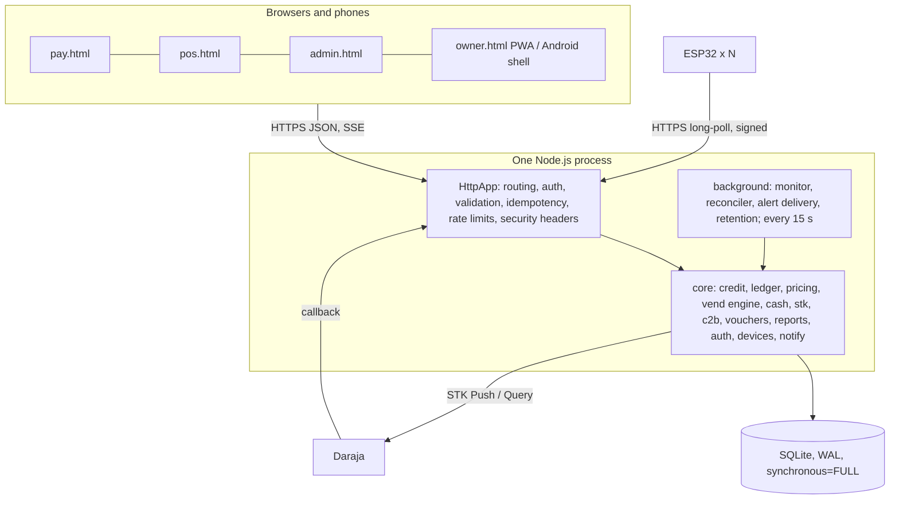

# Architecture

## Components

* **Single source of truth**: the server. Browsers and controllers are untrusted; they can ask but never decide.
* **One database transaction per business event** (`BEGIN IMMEDIATE`): credit a payment, dispatch a vend, apply an ack, close a shift. All checks, ledger postings, state changes and the audit entry commit together or not at all. The write lock serialises concurrent requests the way row locks would in PostgreSQL.
* **No timer**: nothing in the system ends or limits a game by time. "Timeouts" you see are about *communication* (waiting for an acknowledgement, a PIN prompt, a callback).

## Money and games: the ledger
Every change is a set of entries that add to **zero** per unit (`KES` and `GAME`), stored in an append-only table (database triggers refuse UPDATE/DELETE). Balances are `SUM(amount)`; there is no balance column to edit. Key accounts:

| Account | Meaning |
|---|---|
| `asset:mpesa`, `asset:cash`, `asset:coinbox`, `asset:voucher` | where money is |
| `revenue:pool:<table>` | earned from games (negative = credit) |
| `liability:credit:<table>:<owner>` | remainder held as credit |
| `liability:refund_due`, `liability:unallocated` | money owed back / received but not assigned |
| `games:issued` → `games:table:<t>` → `games:inflight:<t>` → `games:vended:<t>` / `games:refunded:<t>` | the life of one game credit |
| `expense:discounts`, `expense:reversal_loss`, `expense:coin_variance` | losses and concessions, visible in reports |

Guards run inside every posting: game balances can never go negative and held credit can never be positive. `verifyLedger` (also shown on the dashboard) checks every transaction nets to zero.

## Exactly-once crediting (three independent layers)
1. `payments` has `UNIQUE(ref_namespace, external_ref)`: one M-Pesa receipt / cash receipt / voucher can credit once. STK and C2B share the `MPESA` namespace, so a C2B echo of an STK payment is ignored.
2. `UNIQUE(idempotency_key)` on payments and an `idempotency_keys` table for HTTP requests.
3. The whole credit runs in one write transaction.

## The vend engine
`dispatch(table)` runs under the write lock: if the table is ACTIVE and online, (in *one-at-a-time* mode) no vend is already in flight, and (if configured) the ready sensor says ready, it moves one or all credits `available → inflight`, creates `QUEUED` vends and signs commands (`SENT`). The device acknowledges → `ACKED` → `CONFIRMED`. See the state diagram in the README; illegal transitions throw and are unit-tested for all 49 state pairs.

**Why a vend ID never changes**: when an ack is lost or the device reboots, the server re-issues the *same vend ID* with a **new nonce**. The firmware remembers executed vend IDs in flash *before* moving the output and answers a repeat with a fresh ack **without releasing again**. At-most-once release is preferred over at-least-once: a missed release is visible and fixable (retry/refund); an extra free game is silent loss.

## Device protocol (HTTPS long-poll)
`POST /api/device/sync` every few seconds (it waits up to 5 s for work, so a payment wakes the table in milliseconds). Request headers: `X-Device-Id`, `X-Ts`, `X-Nonce`, `X-Sig = HMAC-SHA256(secret, METHOD\nPATH\nTS\nNONCE\nSHA256(body))`. The server rejects bad signatures, stale timestamps (±120 s) and replayed nonces. The response carries `X-Resp-Sig`, so the controller authenticates *the server* even if TLS were misconfigured, and `X-Server-Time`, which the device uses (never its own clock) to judge command expiry. Each command is additionally signed (`HMAC-SHA256` over a fixed field order) and has its own nonce and expiry. Details and byte-exact formats: `src/core/command.ts`, `src/core/devices.ts`, `firmware/lib/pooltable_core/protocol.cpp` (cross-checked by tests).

## Payment matching
`mpesa_requests` stores every push this system made (CheckoutRequestID, phone encrypted + hashed, amount). A callback credits only if: the secret path token matches; the CheckoutRequestID is known; the amount equals what we asked for; the phone matches (when Safaricom sends it); the receipt number is new. Unusual situations (late callback after a failure, missing/masked phone) are confirmed with the **STK Query** API first. Everything else becomes an *unallocated payment*.

## Self-healing
Auto-restart (Docker/systemd); **stuck-vend detector** (`sweep`): resend, then FAIL with alert; **orphaned payment reconciler**: queries Daraja for pending/timed-out pushes with exponential backoff for up to an hour and credits successes (with a synthetic reference until the real receipt arrives); **device watchdog**: marks silent tables offline and alerts, alerts when paid credits wait on an offline table; **boot recovery**: on start the server reconciles pending payments, re-issues commands and dispatches stored credits.

## Data model
See [DATA-MODEL.md](DATA-MODEL.md) and the migrations in `migrations/`.
